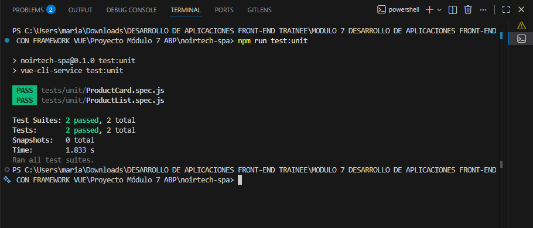
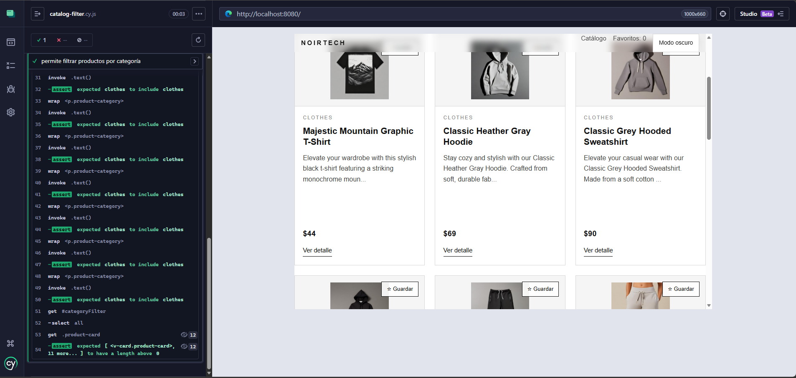

# 🖤 NoirTech – Catálogo de Productos SPA con Vue.js

> 🇬🇧 *Tech e-commerce Single Page Application built with Vue 3, Vue Router and Vuex. Product search, filters and sorting, detail view with gallery and reviews, favorites, shopping cart persisted in localStorage and a simulated checkout with form validation. Tested with Jest and Cypress.*

🔗 **[Ver demo](https://noirtech-spa.vercel.app)**

Proyecto Front-End desarrollado como **Proyecto Módulo #7 | ABP**.

Esta aplicación web fue creada con el objetivo de practicar el desarrollo de una Single Page Application (SPA) utilizando Vue.js, integrando consumo de API, gestión de estado global con Vuex, navegación con Vue Router y una interfaz visual minimalista inspirada en catálogos modernos de e-commerce.

La aplicación funciona como una tienda online de tecnología: permite buscar, filtrar y ordenar productos, ver el detalle con galería y reseñas, guardar favoritos, administrar un carrito de compras y completar un checkout simulado con confirmación de pedido.

---

## Tabla de contenidos

- [Tecnologías](#tecnologías)
- [Conceptos aplicados](#conceptos-aplicados)
- [Objetivos](#objetivos)
- [Estructura del Proyecto](#estructura-del-proyecto)
- [Funcionalidades](#funcionalidades)
- [Navegación SPA](#navegación-spa)
- [Testing](#testing)
- [Cómo ejecutar](#cómo-ejecutar)
- [Notas](#notas)

---

## Tecnologías

- Vue.js 3
- Vue Router
- Vuex
- Vuetify
- Axios
- [DummyJSON](https://dummyjson.com/docs/products) como fuente de productos (categorías de tecnología)
- JavaScript (ES6)
- HTML5
- SCSS
- Vue CLI
- Cypress
- Jest + Vue Test Utils

---

## Conceptos aplicados

- Arquitectura basada en componentes
- Navegación SPA con Vue Router
- Gestión de estado global con Vuex
- Consumo de API REST con Axios
- Renderizado dinámico con:
  - v-for
  - v-if
- Computed properties
- Manejo de eventos
- Filtrado dinámico por categoría
- Gestión de favoritos
- Carrito de compras con persistencia en `localStorage` (plugin de Vuex)
- Validación de formularios
- Guards de navegación (no se puede entrar al checkout con el carrito vacío)
- Organización modular del proyecto
- Testing unitario y end-to-end
- Estilos reutilizables y consistentes

---

## Objetivos

- Implementar una aplicación Single Page Application (SPA) utilizando Vue.js.
- Consumir productos desde una API externa.
- Aplicar arquitectura basada en componentes reutilizables.
- Gestionar el estado global mediante Vuex.
- Implementar navegación entre vistas con Vue Router.
- Filtrar productos dinámicamente por categoría.
- Incorporar una funcionalidad de favoritos.
- Diseñar una interfaz visual minimalista, responsive y consistente.
- Validar comportamiento con pruebas unitarias y e2e.

---

## Estructura del Proyecto

```text
src/
├── components/
│   ├── cart/
│   │   └── OrderSummary.vue        # Resumen de subtotal, envío y total
│   ├── layout/
│   │   ├── AppHeader.vue           # Navegación con contador de favoritos y carrito
│   │   └── AppFooter.vue
│   ├── products/
│   │   ├── ProductCard.vue
│   │   └── ProductList.vue         # Búsqueda, filtro y orden
│   └── shop/
│       ├── PriceTag.vue            # Precio final, original y descuento
│       ├── QuantitySelector.vue
│       └── RatingStars.vue
│
├── views/
│   ├── HomeView.vue
│   ├── ProductDetailView.vue
│   ├── FavoritesView.vue
│   ├── CartView.vue
│   ├── CheckoutView.vue
│   └── OrderConfirmationView.vue
│
├── router/
│   └── index.js
│
├── services/
│   └── productService.js           # Consumo de DummyJSON con Axios
│
├── store/
│   ├── index.js                    # Getters globales y plugin de persistencia
│   └── modules/
│       ├── products.js
│       ├── filters.js              # Categoría, búsqueda y orden
│       ├── favorites.js
│       ├── cart.js
│       ├── orders.js
│       └── ui.js                   # Avisos (toast)
│
├── utils/
│   ├── format.js                   # Precios, descuentos y categorías
│   └── storage.js                  # Lectura y escritura segura en localStorage
│
├── styles/
│   └── main.scss
│
├── App.vue
└── main.js

tests/
└── unit/
    ├── ProductCard.spec.js
    ├── ProductList.spec.js
    ├── cart.spec.js
    └── filters.spec.js

cypress/
└── e2e/
    └── catalog-filter.cy.js

evidencias/
├── evidencia-test-unitarios.png
└── evidencia-test-e2e-cypress.png
```

---

## Funcionalidades

1. Catálogo de productos

Productos de tecnología (smartphones, laptops, tablets y accesorios) obtenidos desde DummyJSON. Cada tarjeta muestra imagen, categoría y marca, valoración, precio con descuento, aviso de pocas unidades y botón para agregar al carrito.

2. Búsqueda, filtro y orden

- Búsqueda por nombre, marca o categoría (ignora mayúsculas y tildes).
- Filtro por categoría.
- Orden por relevancia, precio, valoración o nombre.

3. Detalle de producto

Galería de imágenes, valoración, stock disponible, selector de cantidad, información de envío, garantía y devoluciones, reseñas de clientes y productos relacionados.

4. Favoritos

Cada producto se puede guardar como favorito. Los favoritos se guardan en el navegador y tienen su propia vista.

5. Carrito de compras

- Agregar productos desde el catálogo o el detalle.
- Cambiar cantidades (sin superar el stock) y eliminar productos.
- Subtotal, costo de envío y total. El envío es gratis sobre US$500.
- El carrito se mantiene al recargar la página.

6. Checkout simulado

Formulario con datos de contacto, dirección de envío (regiones de Chile) y método de pago, con validación por campo. Al confirmar se genera un número de pedido y se muestra una pantalla de confirmación. No se realizan cobros reales ni se piden datos de tarjeta.

7. Estados de interfaz

Estados de carga, error, catálogo vacío, búsqueda sin resultados, carrito vacío y avisos al agregar productos.

---

## Navegación SPA

La aplicación utiliza Vue Router para manejar la navegación entre vistas sin recargar la página.

```text
/                    → Catálogo principal
/producto/:id        → Detalle del producto
/favoritos           → Productos favoritos
/carrito             → Carrito de compras
/checkout            → Checkout (requiere productos en el carrito)
/pedido-confirmado   → Confirmación del pedido
```

---

## Testing

El proyecto incluye pruebas automatizadas para validar el comportamiento principal de la aplicación.

- Pruebas unitarias

Se implementaron 10 pruebas unitarias con Jest y Vue Test Utils:

- Renderizado básico del componente ProductCard
- Visualización del estado vacío en ProductList
- Carrito: precio con descuento, suma de cantidades, límite de stock, costo de envío, eliminar y vaciar, aviso al agregar
- Catálogo: búsqueda, combinación de filtros y orden por precio y valoración

- Prueba e2e

Se implementó 1 prueba end-to-end con Cypress:

- Flujo de filtrado de productos por categoría

### Evidencias

| Pruebas unitarias (Jest) | Prueba e2e (Cypress) |
|--------------------------|----------------------|
|  |  |

---

## Cómo ejecutar

1. Descargar o clonar el repositorio.
2. Instalar las dependencias:

```bash
npm install
```

3. Levantar el servidor de desarrollo:

```bash
npm run serve
```

4. Ejecutar pruebas unitarias:

```bash
npm run test:unit
```

5. Ejecutar Cypress:

```bash
npx cypress open
```

---

## Notas

- El proyecto fue desarrollado con enfoque SPA utilizando Vue.js 3 y Vue CLI.
- Se utilizó Vuex para centralizar el manejo de productos, filtros, favoritos, carrito y pedidos.
- La interfaz fue diseñada con una estética minimalista en blanco y negro, inspirada en catálogos modernos de e-commerce.
- Vuetify fue integrado como librería de UI base, combinándose con estilos personalizados en SCSS.
- El carrito, los favoritos y el último pedido se guardan en `localStorage` mediante un plugin de Vuex.
- La aplicación fue estructurada de forma modular para facilitar futuras mejoras como paginación, cuentas de usuario o un backend real.

---

👩‍💻 Desarrollado por **Mariangel Colina** · [GitHub](https://github.com/marycolinam) · [LinkedIn](https://www.linkedin.com/in/marycolinam/) · [Portfolio](https://marycodes.vercel.app)
